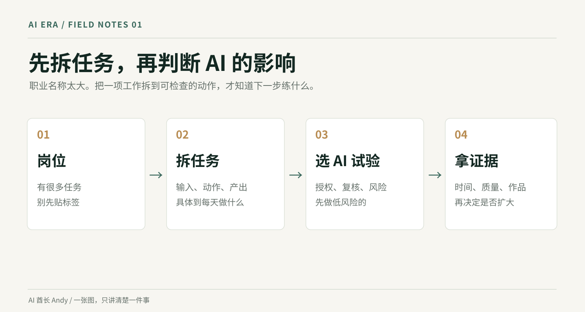
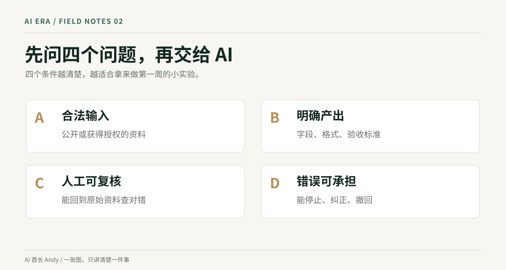
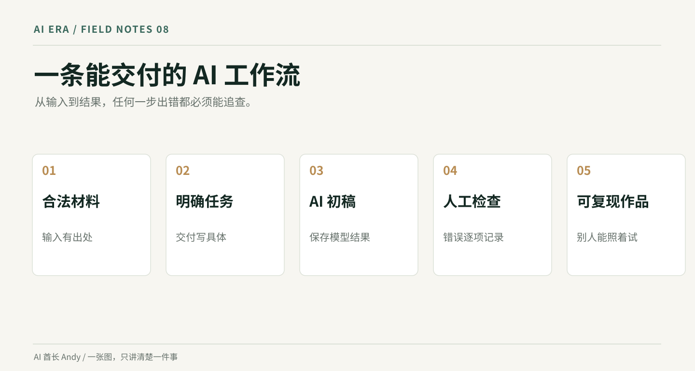
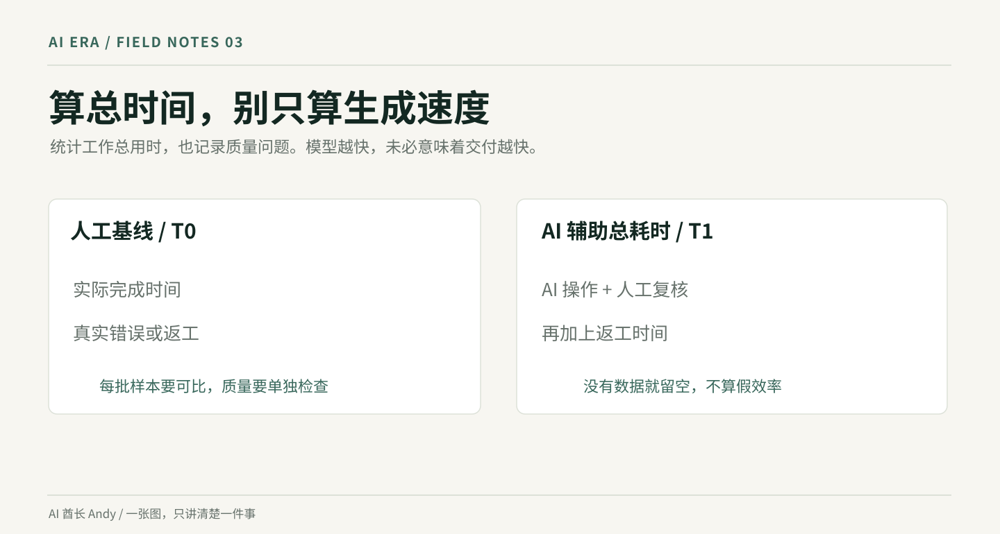
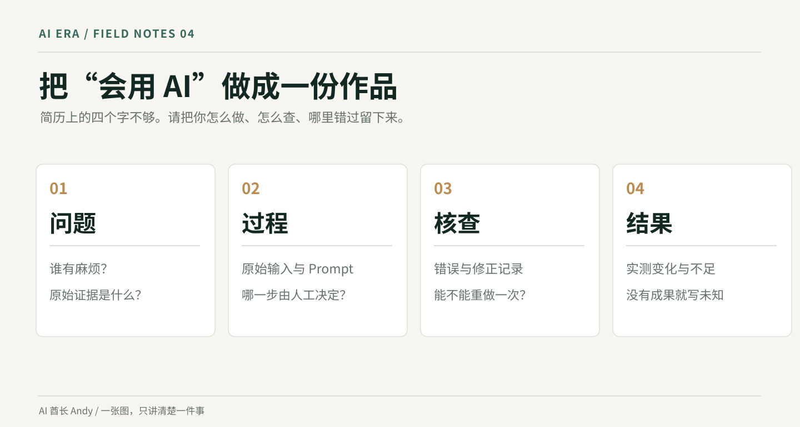
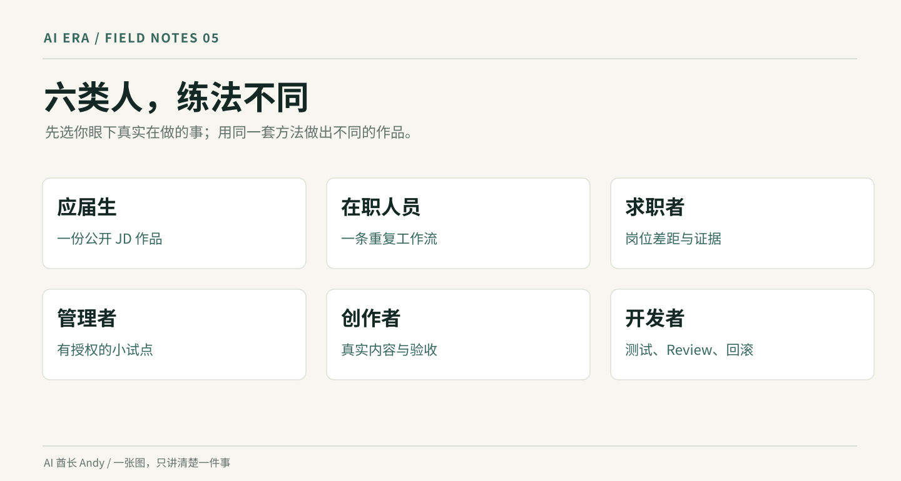
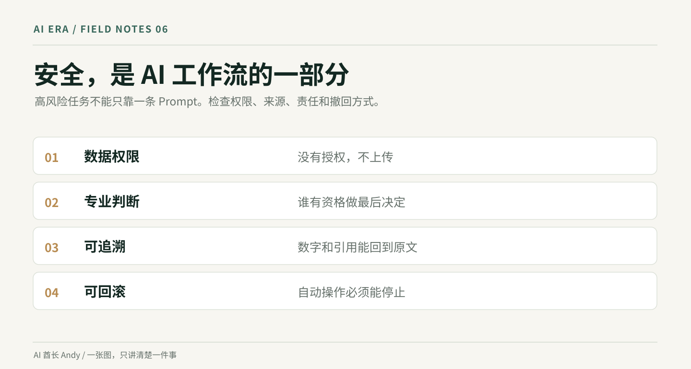

# AI 时代不被淘汰保姆级指南

**AI 酋长 Andy｜2026 年 10 月整理｜持续更新**

你每天在公司里干的活，哪些已经能让 AI 做？哪些暂时还不行？如果领导让你用 AI 把同一件事做快一倍，你知道从哪儿下手吗？

我做过多年 B 端 AI 产品，现在也在做内容和咨询。最近接触工作和转型方面的问题，一个很明显的变化是：大家都知道 AI 很厉害，但一问自己的岗位该怎么用，就开始说工具名字。会打开聊天框，离真正解决工作问题还有一段距离。

我自己也踩过坑。AI 可以很快帮我写网页、整理文章，但生成的 HTML 放进公众号，还是会报一堆排版错误。浏览器里能打开，交到别人手上未必能用。最后那些检查、修改、交付的工作，一样得有人负责。

这篇就讲实际的。先看你的岗位受到什么影响，再找一个每天都在做的任务，用 AI 完成一次，测时间、查错误、留下作品。最后把这些证据用到工作、求职或职业转型里。

全文的训练周期分三段：**7 天做出第一个结果，30 天建立自己的工作流程，90 天积累能够向别人展示的成果。** 这是行动时间表，无法保证任何人永远不会失业，也不承诺涨薪或拿到 offer。



## 一、先把“被 AI 淘汰”说清楚

网上经常有人说某个岗位要消失了。我建议先问一句：**消失的是整个岗位，还是这个岗位里的一部分工作？**

2025 年国际劳工组织与 NASK 的研究估计，全球约四分之一的工作处在某种程度的生成式 AI 暴露范围内。研究同时强调，更常见的情况可能是工作内容被改造，不能把“任务受到影响”直接换算成“岗位马上消失”。来源：[ILO，2025](https://www.ilo.org/resource/news/one-four-jobs-risk-being-transformed-genai-new-ilo%E2%80%93nask-global-index-shows)。

世界经济论坛的《2025 年未来就业报告》预计，到 2030 年，现有工作所需技能中约 39% 将发生变化或不再适用。这个数字是基于企业调查形成的预测，既包括 AI，也受人口结构、经济与其他技术变化影响。不能据此说“AI 将淘汰 39% 的人”。来源：[WEF，2025](https://www.weforum.org/publications/the-future-of-jobs-report-2025/)。

| 你听到的说法 | 应该怎么理解 |
|---|---|
| AI 能写报告，所以报告岗位要没了 | 先分出找资料、整理、判断、沟通、承担结果这几项任务 |
| 某职业 AI 暴露程度高 | 说明工作中有更多任务可以受 AI 影响，不能直接推算个人失业概率 |
| 企业都在用 Agent | 先看这个 Agent 能否在真实数据和流程里稳定工作 |
| 以后只要会写 Prompt | 工具和界面都会变。业务理解、核查、交付和责任更值得积累 |

对个人来说，有四种需要区分的变化：

1. **工作变快。** 原来要两小时整理材料，现在一小时能完成。团队可能会要求你做更多事。
2. **工作被重新组合。** AI 做初稿，人来确认事实、判断取舍、和客户沟通。
3. **岗位要求提高。** 招聘广告可能要求你会使用 AI 工具，还要拿得出实际成果。
4. **部分工作需求收缩。** 如果某项工作非常标准化、重复多、容易验收，公司可能减少相关投入。具体速度取决于行业、管理和成本，不能凭职业名称断言。

先别问“AI 能不能替代我”，拿出你的工作清单，我们一项项看。


### 国家政策到底在推动什么？先看四份原始文件

**第一份：2025 年国务院《人工智能+》行动意见。** 国发〔2025〕11 号提出跨行业推广 AI 应用和智能体的发展目标，重点涉及产业、科学、民生等领域。这里有发展方向，**没有任何一个人的就业保证**。你要做的是回头查看自己行业里已经存在的 AI 工作任务，顺便核对招聘 JD 有没有具体要求。[国务院公文](https://www.cac.gov.cn/2025-08/27/c_1758018277755538.htm)。

**第二份：2025—2027 年职业技能提升培训行动。** 国就劳发〔2025〕4 号提到面向重点行业和人群开展补贴性培训，**3000 万人次以上是三年全国培训目标**。你能否参加、要不要垫资、当地有哪些班，必须看参保地和培训所在地的官方公告，不能拿全国目标推算自己的补贴。[中国政府网](https://www.gov.cn/zhengce/zhengceku/202507/content_7032222.htm)。

**第三份：2026 年《人工智能+人社》实施意见。** 人社部发〔2026〕40 号涉及职业图谱、岗位匹配、智慧招聘、职业指导和培训等公共服务场景。**写入文件不等于你所在地已经上线**。到官方公共就业平台核实是否有真实可用的功能，再决定用什么。[国家数据局公开文件](https://www.nda.gov.cn/sjj/zwgk/zcfb/0708/20260708133949899211227_pc.html)。

**第四份：个人信息与 AI 内容标识规则。** 客户简历不能因为方便就传给外部 AI；公开发布生成合成内容，应按适用法规及平台要求声明和标识。《个人信息保护法》强调合法、必要、最小化；《人工智能生成合成内容标识办法》于 2025 年 9 月 1 日施行。[个人信息保护法](https://fgk.chinatax.gov.cn/zcfgk/c100009/c5211776/content.html) · [标识办法](https://www.cac.gov.cn/2025-03/14/c_1743654684782215.htm)。

**怎么看政策才不会被坑？**打开官网，核对日期、文号、适用人群、当地承办机构，再去看与你想求的岗位有无实际关系。政策是方向，招聘要求和合法的真实练习才是你今天能动手的事。细节见 [《政策与办理路径》](docs/19-policy-and-opportunities.md)。

### 真实企业里发生了什么？不能只讲 AI 很厉害

| 真实证据 | 发生了什么 | 你该学什么 | 不能理解成什么 |
|---|---|---|---|
| [NBER 客服现场研究](https://www.nber.org/papers/w31161) | 研究一家企业 **5,179 名客服**，AI 助手使每小时处理量平均增加约 **14%**，新手受益更大 | 重复问题先做 AI 建议，再人工核对 | 所有客服都能提效 14% |
| [HBS × BCG 顾问实验](https://aiinstitute.hbs.edu/navigating-the-jagged-technological-frontier/) | **758 名顾问**在 AI 擅长的实验任务上做得更快、质量评分更高 | 挑适合 AI 的任务，保留判断 | 整个咨询行业可直接自动化 |
| [METR 开发者实验](https://metr.org/blog/2025-07-10-early-2025-ai-experienced-os-dev-study/) | **16 名开发者、246 项任务**，在 2025 年特定环境里使用 AI 平均多花约 **19%** 时间 | 总时间要算复核、测试和返工 | AI 永远会拖慢所有开发者 |
| [Klarna 战略调整](https://www.reuters.com/business/swedens-klarna-shifts-ai-focus-cost-cuts-growth-2025-09-10/) | 曾重度宣传 AI 降本，2025 年调整重点，重新强调服务质量与增长 | 处理量之外还看投诉、转人工和结果 | “AI 相当于 700 人”就是实际裁了 700 人 |
| [Shopify 内部 AI 要求](https://www.shopify.com/news/unserious-exploration) | 2025 年管理层将适当使用 AI 作为内部工作习惯要求 | 看自己目标雇主的真实岗位要求 | 所有企业都会一样、会 AI 就保住工作 |

这些例子放在一起，你就知道为什么我坚持让读者**人工做一次、AI 做一次、把错误和总时间一起测**。一家公司用得好，不代表你所在公司照着用就会好；某项实验变慢，也不表示其他任务不用 AI。还有一个容易被忽略的点：**就业变化可能先反映在初级岗位招聘，而非现有员工立即被裁**。Anthropic 2026 年美国数据研究尚未发现高暴露岗位失业率系统性上升，对年轻人招聘放缓的迹象仍然谨慎。[研究原文](https://www.anthropic.com/research/labor-market-impacts)。

这些研究是具体公司、任务、地点和工具的证据，不能当作中国所有岗位的预测。要逐条核对，看 [《六个真实案例》](docs/20-real-world-cases.md)；想知道职业变化的原因，看 [《为什么岗位会变化》](docs/21-why-change.md)。

## 二、第一步：把你的工作拆到任务层

很多人写简历会写“负责内容运营”“负责产品管理”“负责商务”。这种话太大了，AI 能做多少没法判断。

你需要把工作拆成一件件真实发生的事。以一个运营同学的周一为例（**教学示例，不是真实客户记录**）：

| 工作任务 | 输入 | 交付给谁 | 现在怎么做 | 谁最终验收 |
|---|---|---|---|---|
| 整理上周留言 | 公开评论 | 负责人 | 手工复制并分类 | 负责人 |
| 写活动文案初稿 | 产品卖点、活动规则 | 设计和运营 | 参考旧稿重写 | 运营负责人 |
| 判断活动原因 | 投放数据与用户反馈 | 项目组 | 对比指标、追问渠道 | 业务负责人 |
| 回复投诉 | 客户信息与承诺 | 客户 | 查询订单并协调 | 客服负责人 |
| 复盘会议 | 讨论记录和待办 | 项目成员 | 手工整理纪要 | 会议负责人 |

第一项可能很适合 AI 辅助分类；第二项适合先出草稿；第三项不能让 AI 凭想象写原因；第四项涉及隐私和公司承诺，要按权限执行；第五项可以由 AI 草拟纪要，但负责人需要确认决定与待办。

**你现在就做。**打开一个表格，把过去五个工作日真正做过的事情写出来。建议先列 15—30 项，不要求恰好 20 项。每项填五列：输入、步骤、产出、频率、出错代价。可以直接复制 [任务清单模板](templates/task-inventory.md)。

### 一条可直接用的 Prompt

```text
你是一位工作任务分析师。
我的岗位：[岗位]
最近5天真实做过的事：[逐条粘贴]
我拥有的工具和权限：[真实情况]
请把工作拆成具体任务，每行只保留一个可以交付的动作。
输出：任务、输入、动作、产出、频率、验收者、需要人工判断的地方。
不要根据岗位名称编造我没做过的工作。
缺少信息请标注“待补充”，优先问我最重要的3个问题。
```

**这一关的完成标准：**能拿出一张清单，领导或同事看一眼就知道你每天具体做了什么。如果一行里还写着“负责战略增长”，继续拆。



## 三、第二步：判断哪些任务适合交给 AI

这里给你一张简单的四问表。它是**自己安排实验的工具，不是研究机构提供的失业概率模型**。

- **能否拿到合法的输入？** 比如公开招聘 JD、匿名样本、自己写的文字。没有授权的客户资料，先别传。
- **能不能说清产出长什么样？** 例如表格要有哪几列，纪要要保留哪些决策。
- **结果能否被人快速检查？** 能核对原始材料、公式和引用，比无法验证的“市场一定会增长”更适合起步。
- **出错的代价能否承受？** 错一个活动文案还可以改；泄露客户隐私、发错财务数据，成本就高得多。

你可以用下面的矩阵选第一个练习：

| | 能快速复核 | 难以快速复核 |
|---|---|---|
| 低风险 | **优先练**：格式整理、公开资料归纳、文案草稿 | 小范围试验，保留人工检查 |
| 高风险 | 有权限、有复核流程再试 | 暂缓自动化，交给有责任权限的人判断 |

**第一周别碰最难的任务。**挑一项低风险、每周至少重复一次、自己能检查好坏的工作。用 [任务机会评估模板](templates/opportunity-scorecard.md) 记录原因。

### 你可能想问：我的岗位风险到底是多少？

个人没有足够信息时，我不会给你一个“失业概率 87%”的数字。你可以整理一个**关注顺序**，但不应把自评总分叫作真实概率。对岗位最有用的判断，是哪些具体任务已经能用现有工具完成、哪些仍需要你承担责任，以及公司是否真的在调整工作流程。

## 四、第三步：学会一套工作方法，不用追十种工具

我推荐从一个固定流程开始：**给材料 → 说明任务 → 提出验收标准 → 做出初稿 → 找回原始证据 → 人工确认。**

比如你想整理一份公开招聘 JD。你把岗位正文给 AI，要求它只提取职位名称、职责、技能、年限、所在城市，并把每条要求连回原文。再逐行核查，遇到模糊的技能要求，别让它自作主张解释成具体经验年限。

同样一段 JD，能直接复制走的结果是一张有列名、有出处的表；“这个岗位很适合你”这种笼统判断没什么用。

**最小工具组合：**一个你能合法正常使用的 AI 助手、一个文档或表格、一处能保存原始证据的文件夹。免费版本能完成验证就先用免费的。不要一口气买几个会员。

工具选择只看五点：是否可用、数据怎么处理、能否导出、产出是否方便核查、你能否承担成本。功能会变，入口也会变，别把整套能力绑在某一家工具上。



### 万能任务指令

```text
我要完成：[具体工作任务]。
原始材料：[粘贴已授权的材料]
使用范围：[允许使用的数据与工具]
输出格式：[表头、字数、结构或示例]
验收标准：[必须准确的字段与禁止的错误]
请先检查信息够不够；缺少就列出来，不要猜。
生成后提供“逐项核验清单”，标记来源不确定的部分。
```

## 五、第四步：同一项工作，做一次前后对比

我建议你找一个真实任务，比如整理上周的公开评论。先不用 AI 完成一次，记录耗时和错误；再把同一批公开材料交给 AI 辅助处理，记录总耗时，**包括写指令、复核、修改的时间**。

对比时只看三个东西：

- **总时间。** `原始耗时`、`AI 操作耗时`、`复核修改耗时`分别记录。总时间是后两者之和。
- **质量。** 比如 20 条分类中有多少需要重新归类。数量一定要实际数过。
- **可重复性。** 下周换一批材料，别人能不能按你的说明再次跑出来。

假设一个演示案例：人工整理一批公开评论花了 70 分钟；AI 初稿花 12 分钟，人工复核 25 分钟，总共 37 分钟。**这些是演算示例，不是我的客户成绩。**如果 AI 少分类了三条重要意见，节省的时间还要和错误代价一起考虑。更好的做法是把遗漏类型写进复核清单，下次再测。

> **结果要写成这样：**“某次样本中，人工 70 分钟；AI 辅助含复核 37 分钟；复核发现 3 条分类问题。尚未测试更多批次。”

别写“效率提升 300%”或者“彻底解放双手”。只写真的测过的东西。



### 直接使用这个复盘 Prompt

```text
这是一次工作测试的真实记录：[填写]
人工用时：[分钟]
AI生成用时：[分钟]
人工检查修改用时：[分钟]
输入数量与错误数量：[数据]
请算出总用时与变化比例，清楚区分时间节省和质量变化。
说明样本大小、不确定因素和下次需要复测的条件。
如果没有基准数据，就不要推算效率提升。
```

## 六、第五步：把会用 AI 变成可被看见的能力

你说自己“熟练使用 AI”，面试官很难判断真假。你可以拿出一份小作品，把问题、输入材料、处理流程、检查方法、结果放在一起。

例如你是一位产品经理：

1. 从官网收集公开的三个产品功能说明，保留来源链接。
2. 选出一个实际的用户问题，例如“功能太多，第一次使用不知道点哪里”。
3. 用 AI 整理产品的流程差异，自己逐项复核。
4. 画出一版更简单的使用流程，说明取舍。
5. 找一位真实用户试用你的原型，记录他在哪里停住。
6. 做成 3 页案例：问题、过程、验证。不要说某个不存在的功能让转化率提高了多少。

这个作品很小，却能让人看到你怎么思考、怎么用工具、怎么检查结果。对求职者来说，比在简历里写“精通 Prompt”更具体。

模板直接拿走：[项目作品卡](templates/portfolio-case.md)，[匿名作品示例](examples/product-manager-case.md)。



## 七、六种人，分别先练什么

你可以先按身份找自己的起点。下面都是起步练习，**具体结果由实际执行决定**。

### 1. 学生和应届生

先看 10 条目标岗位的公开招聘 JD，把反复出现的技能归在一起。选一个能做的小作品，不需要先投简历海投。比如想做运营，完成一份公开内容数据的分析；想做产品，完成一个产品体验和改版建议。要能回答“数据从哪来、做错了怎么查”。参考 [应届生示例](examples/graduate-case.md)。

### 2. 工作几年、担心岗位变化的职场人

选一项每周重复的任务。建立工作底稿、AI 指令、人工检查清单。跑通三次，再把真实节省的时间与质量问题整理成一页报告，找负责人讨论是否值得纳入团队流程。参考 [运营示例](examples/operations-case.md)。

### 3. 正在找工作的人

先拆 5—10 条真正准备投递的 JD，做能力差距表。用 AI 帮你检查简历是否有事实、逻辑和表述问题，项目经历必须真实。模拟面试后记录回答中缺了哪些证据，按岗位补作品，不要编造学历、任职、项目结果。参考 [求职示例](examples/jobseeker-case.md)。

### 4. 管理者或小团队负责人

先盘点团队高频任务和最常见的返工。只选一个低风险流程，找一位实际使用者共同测试。说清审批权、数据权限、人工复核人和终止条件。不要把客户信息直接上传到未经批准的外部工具。参考 [团队负责人示例](examples/manager-case.md)。

### 5. 内容创作者和自由职业者

用 AI 做选题素材归档、文字整理、封面结构草案、跨平台格式调整，保留自己的观点和真实经历。注意图片授权、引用来源、平台 AI 标识和推广披露。作品最后能否在公众号、视频号等目标平台正常显示，要实际验收。参考 [内容案例](examples/creator-case.md)。

### 6. 程序员和 AI 产品从业者

找一个真实且边界清楚的需求，用 AI 辅助写测试、生成脚手架、补文档，但每次都要自己 review diff、跑测试、检查依赖和权限。AI 写出的代码能够运行，离安全上线还差监控、鉴权、回滚和故障排查。参考 [开发者案例](examples/developer-case.md)。



## 八、求职时，怎样展示自己适应 AI 的能力

把招聘 JD 打开。先拿荧光笔圈出四种信息：工作结果、需要协作的人、必备技能、能证明能力的项目。再打开自己的简历，逐项找证据。缺的不要让 AI 帮你编，安排一个小作品去补。

比如 JD 写“能够进行用户研究和产品分析”。你有一次真实的用户访谈吗？有没有访谈提纲、记录、结论？有没有因为访谈结果而调整过产品设计？如果没有，先找允许研究的公开场景做一轮练习，而不是在简历里写“用户洞察能力强”。

### 简历里可以怎么写

不推荐：`熟练掌握各类大模型工具，具备卓越 AI 思维。`

可以按实际情况写：`使用 AI 辅助整理公开用户评论，建立主题分类表；人工复核分类结果并修正错误，输出一页需求分析报告。` 如果测过时间，还可以写实测时间和样本大小；没有测过，就不要补数据。

面试官追问时，你要能打开作品，展示原始输入、AI 输出、人工修改，以及你为什么做这个判断。这比背几个新名词更有说服力。

求职自查模板：[岗位差距清单](templates/job-match.md)；提示词：[JD 到作品规划](prompts/07-job-match.md)。

## 九、哪些东西一定不能直接交给 AI

这部分比“十个必装工具”更重要。

**第一类，未经授权的资料。** 客户姓名、联系方式、简历、合同、内部账单、源代码、账号密码、密钥。没得到授权，也没确认数据去向，就不要粘贴给外部服务。

**第二类，需要专业责任的结论。** 医疗诊断、法律结论、财务税务决策、重要合同条款、招聘歧视相关判断。可以用 AI 帮助整理问题，但最后交给有权限和资质的人确认。

**第三类，无法核查却会对外传播的内容。** “某公司裁员 80%”“某工具已经完全取代人类”“我的客户全部涨薪”。先找原始出处，别直接发。

**第四类，自动执行后难以挽回的操作。** 批量删除数据、自动付款、对外群发邮件、发布平台账号内容、修改生产系统权限。先做沙盒测试，设置人审和回滚方式。

NIST 的 AI 风险管理框架及生成式 AI 专项指引，把可靠性、隐私、安全、透明度等放在重要位置。这些并不会被一个“高级 Prompt”自动解决。来源：[NIST AI RMF](https://www.nist.gov/itl/ai-risk-management-framework)。



拿走 [发布与隐私检查表](templates/security-checklist.md)，每次交付前过一遍。

## 十、如果公司不让你用 AI 怎么办

先看公司有没有明确政策。禁止上传客户信息和内部文档，就按照规定执行。可以用公开资料或自行编写的测试数据，先练工具基本操作。不要为了证明能力，绕过公司安全制度。

如果公司允许试点，可以准备一页申请：要改进哪个流程、材料从哪来、是否包含私人数据、谁复核、最坏后果是什么、试点需要多少时间、什么情况下停止。负责人批准后再做。

一项小流程跑通三次，比和同事争论一百遍“AI 是未来”更容易推动改变。

## 十一、七天训练：从焦虑到一份能检查的作品

从今天开始，先留出每天 60—90 分钟。时间不够可以拉长周期，**不要为了打卡牺牲睡眠或当前工作**。

| 日期 | 今天做什么 | 结束时必须有的东西 |
|---|---|---|
| Day 1 | 写出过去五个工作日的任务 | 至少 15 项真实任务，不足就照实记录 |
| Day 2 | 找一个低风险高频任务 | 一张有授权和验收标准的任务卡 |
| Day 3 | 不用 AI 完成一次 | 原始材料、用时、质量基准 |
| Day 4 | 用 AI 完成同一类任务 | Prompt、AI 输出、人工修改记录 |
| Day 5 | 算总耗时、复核错误 | 一张数据真实的前后对照表 |
| Day 6 | 整理成可展示的作品 | 2—3 页匿名案例、可复现步骤 |
| Day 7 | 对照岗位要求，确定下一步 | 继续 / 修改 / 暂停的理由，30 天方向 |


[打开逐日详细步骤](docs/07-seven-days.md) · [可离线打卡网页](index.html#challenge)

### 七天执行教练 Prompt

```text
我是[岗位/求职状态]。我过去五天做过的事：[真实任务]。
每天可用时间：[分钟]，可使用的工具：[具体工具]。
请按“拆任务、选任务、做基线、AI试验、检查对比、写作品、做复盘”安排七天。
每次只给我今天的3个动作，写清所需材料、操作步骤、产出和验收标准。
我没提供的数据一律留空，不许假定实验成功。
涉及隐私、公司权限和高风险操作时请提醒我先停止并确认。
```

## 十二、30 天，把一次偶然成功变成稳定工作方法

第一周：照上面的 7 天计划做出第一份作品。第二周：找 2—3 个真实批次复测，检查你的流程是不是只对某一份材料有效。第三周：把可重复的步骤写成 SOP，让另一个人按说明试，记录他哪一步出错。第四周：整理出第二个作品，或者把第一个做成可复用模板，并将结果用在实际工作汇报、求职案例或合作提案中。

你应该积累的是：**原始材料（脱敏）、任务说明、Prompt、人工检查规则、实际测量数据、修改记录、最终成果。** 30 天过后，至少应该比第 1 天更清楚自己会做什么、哪里还不会。

[30 天详细路线](docs/08-thirty-days.md)

## 十三、90 天，决定你的下一条职业路线

90 天用来观察某项能力能否持续创造价值。你可以保留两条线：

- **眼前的工作与收入：** 先把已有任务做好，把能证明的结果呈现给团队或下一家公司的面试官。
- **未来的能力资产：** 每月留下一份可复用作品、一个可靠的工作流、一些经过核实的行业理解。

每个月问自己四个问题：新工具改变了哪些任务？我靠什么拿到真实反馈？哪些环节仍需要我判断或担责？把这套方法交给别人，他能不能做出来？

如果岗位需求明显变化，就开始研究内部转岗、外部岗位和可迁移技能。具体选项要结合收入压力、家庭和当地就业环境决定。不要因为一篇文章冲动辞职。

[90 天路线](docs/09-ninety-days.md)

## 十四、十个常见错误，照着避开

1. **每天只刷 AI 新闻。** 收藏十条演示，没有一次实际交付。
2. **把岗位当成一整块。** 连自己有哪些任务都说不出来。
3. **没有授权就上传公司资料。** 可能把工作问题变成信息安全问题。
4. **只看生成速度。** 复核用了两小时，算效率时却漏掉。
5. **用演示效果冒充工作成果。** 跑通一次，没测试不同输入。
6. **把阅读量当成业务结果。** 有人看、有人问、有人付款，分开记录。
7. **简历写得很会用 AI。** 面试官一追问，拿不出作品和底稿。
8. **追最贵的会员。** 旧工具还能用，就先别加订阅。
9. **一口气自动化所有流程。** 权限和错误处理跟不上。
10. **认为七天能改变命运。** 七天最多完成第一轮练习。后面还得持续更新。

## 十五、完全没用过 AI，今天从哪里开始？

先别着急装插件、租服务器，更没必要买“提示词大师课”。你需要的是一个能正常打开的 AI 助手、一份**公开或者自己编的材料**，和一个能保存结果的文档。手机也能完成起步练习，处理表格时电脑方便一些。中国大陆常用工具或海外工具的可用范围、政策、账户权限会变化，使用你所在地区和公司允许的工具就行。

这里给你一个现成的练习。仓库的 [`labs/feedback-24.csv`](labs/feedback-24.csv) 有 24 条我为教学编写的虚构商品评价。每一条带一个编号。现在打开文件，先自己给前八条分类，分成价格、功能、履约、其他、需人工复核五类。记录花了几分钟。接着打开你能用的 AI 助手，新建对话，把完整数据和分类规则复制进去，让 AI 只返回 `id,category` 两列。输出以后打开 [离线评分页](lab.html)，粘贴进去核对。找出漏了哪些 ID、把哪几条分错了。

你会发现一个有意思的细节：有些评论根本不适合靠关键词直接分类。比如“付款失败，还显示已扣款”，表面上是付款问题，但处理它需要查订单和支付状态，这种情况下我宁可把它先标成“需人工复核”。**真正能交付的工作流程，需要知道哪些情况不应该让 AI 猜。**

操作遇到问题，先看三件事：输入格式对吗？原文有没有被截断？AI 有没有把你给的分类规则改掉？先用五条样本试通，再放大到 24 条。连五条都做不对，别急着研究 Agent。

[详细到复制和评分的教程](docs/13-ai-tools-selection.md) · [24 条评分器](lab.html) · [低预算版本](docs/18-low-budget-and-no-access.md)

### 失业时，先查得到的公共保障，再决定培训预算

失业保险金的基本条件涉及缴纳失业保险满一年、非本人意愿中断就业等要求；具体资格、登记与申领以当地最新规则为准。先通过 [全国人社政务服务平台办理指南](https://www.12333.gov.cn/portal/common/bszn/sydysl) 查询入口，必要时咨询参保地经办部门。**不要误把高价培训当成必须先交的“上岸费”。**是否能参加补贴培训，也必须在当地官方公告里核验。这一套核验问题已经做成 [可填写表格](templates/policy-check.md)。

## 十六、如果你已经失业，最该做的可能根本不是学 AI

失业的人和坐在办公室里研究工作流的人，优先级不一样。你可能正在付房租、还贷款、养家，或者离下一笔收入还有一段时间。这时候不要因为网上说“AI 会取代所有人”，就花上万元报一个课程。先算生活费还能撑多久、之前的经验在哪类岗位里还能直接使用、现有招聘渠道有没有响应。

给求职划出固定时间。选三类职位：自己能马上上手的、需要补一小块能力的、差距很大的转型岗位。前两类先投，第三类用小成本试。你有五年产品经验，就先看需要产品能力的 AI 岗位；别只因为新岗位名里带“算法”就从零重学一整套数学。

怎么用 AI 帮自己找工作？先找五到十条**真实的 JD**，把岗位职责、技能、经验要求逐条摘出来。再把自己的履历放在旁边，每条要求都找一段经历或者作品来证明。没有做过就写没有。让 AI 帮你发现表述不清的地方可以，绝对别让它给你编公司、学历、项目和绩效。随后做一次模拟面试，让它追问：你亲手做了什么？结果有谁验收？这个数字从哪里来？

有一个误区要避开：**做作品也会让人上瘾。**把第三个网站搭好、第五版简历做完，如果始终不投递、不联系招聘方，还是拿不到市场反馈。职位链接、投递日期、是否有回音、卡在哪一轮，都应该记录。连续两周没面试，先回头看定位和渠道；面试不少却总失败，重点改准备和表达。别用刷 AI 新闻代替求职。

[失业时的收入与求职防线](docs/11-career-defense.md) · [JD 到面试完整方法](docs/12-job-search.md)

## 十七、在职的人怎么做，才不会把 AI 学习变成工作事故？

想把一个新工具带进公司，先弄清楚谁允许你用、哪些资料可以用、出了问题谁负责。客户名单、合同、内部财务、还没公开的产品资料，都不适合直接贴进个人聊天账号。公司禁止外部 AI，就用本项目的虚构数据练习。**不要拿规避安全制度来证明自己很懂技术。**

真正适合做第一次试验的是一段小流程。比如一周要整理一次公开评论，先拿上周已经公开的样本，确定输出的五个主题、哪些必须人工复核、哪些情况属于失败。找负责人确认规则，然后对照“全部手工”和“AI 先整理、人工再检查”分别花多少时间。结果变慢了也照实写。

三次试验都能交付，再谈是否让团队用。给领导汇报时别说“我已经实现全面自动化”，直接拿出一页纸：以前谁做、每次多久、现在一共多久、返工多少条、风险怎么管、下一批谁来验收。领导最需要知道的是能不能稳定交付、会不会出事。

尤其注意 Agent。可以操作文件、邮件、浏览器和数据库的 AI，权限比只回答问题的聊天工具高很多。第一次试验优先只读权限；删除、修改生产数据、对外发送、付款，必须有明确授权、人工确认和回滚。仓库中的网页、客户邮件和外部材料都可能混进诱导 AI 越权的内容，外部文字不能当成给 Agent 的系统命令。

[企业数据与 Agent 检查表](docs/14-security-and-compliance.md) · [给领导看的工作流模板](templates/workflow-sop.md)

## 十八、怎么判断“我真的学会了”，而不是 AI 在替我考试？

我建议用一个很笨的标准。把你做的作品交给另一个人，**不给他打开你之前的对话**，只提供任务说明、公开或授权的输入、运行步骤、验收规则。让他照着做。如果他做不出来，说明还有一部分知识只存在你的脑子里。你可以教他，但不能因为自己的电脑里跑通一次就说“已经形成工作流”。

再加一个反向测试。故意给 AI 一条难分类的信息、一个缺失的字段、一份不存在的来源，看看它会不会瞎补、有没有拒绝、是否提醒人工检查。得到好看的文字不难，发现它错在哪里才是岗位能力的一部分。

最终要留下四样东西：`输入原件`、`操作步骤`、`人工修改记录`、`结果与局限`。一个真实可复核的案例，比十张漂亮的工作流图更有价值。我做 AI 产品和内容时，也见过 HTML 在普通浏览器里能打开，复制进公众号却报一堆格式错误。这种问题要到目标环境里才会暴露，所以验收必须放在真正使用的地方。

作品能不能写进简历？可以写**你确实做过的动作**，例如“使用 AI 辅助分类 24 条虚构反馈，按预先设定的标准答案复核，并纠正四条示例错误”。但如果你只是运行了仓库里的教学数据，就得明确标注个人练习，不要写成自己为某家电商提升了真实业务指标。

[作品的六项评审标准](docs/17-portfolio-review.md) · [评估协议](docs/15-evaluation-protocol.md)

## 十九、AI 让人变快还是变慢？别光看演示

这个问题，我专门查了几份相互不完全一致的研究。美国一项客服辅助研究跟踪了数千名客服员工，发现被研究系统帮助的新手平均改善更明显。另一项 2025 年针对资深开源开发者的随机实验却发现，在当时的工具和任务条件下，AI 辅助组平均反而多花了 19% 的时间。到了 2026 年，这家研究机构又说明，新一轮实验受到参与者选择等偏差影响，暂时无法可靠估计最新工具带来的速度变化。

这三件事并不矛盾。任务不同、使用者不同、工具不同，结论自然不同。**“AI 提效”要改成“AI 是否在我这件事上、连同复核一起提高了效率”。**别引用别人实验里的数字给自己的作品包装成绩。

还有一种情况：AI 生成的速度确实很快，但质量变差了。比如客服漏掉一条严重投诉、分析报告编了一个不存在的出处、代码运行起来却把权限放得太宽。复核和修复的时间必须算在成本里。严重错误有时不能简单用效率收益抵消。

我的建议很明确。第一轮用小样练流程，第二轮换一批样本做复测，第三轮让别人按你的说明再跑一次。总耗时、质量、可重复性至少三项达标，才考虑扩大使用。

**研究出处：**[NBER 客服现场研究](https://www.nber.org/papers/w31161)；[METR 2025 年随机实验](https://metr.org/blog/2025-07-10-early-2025-ai-experienced-os-dev-study/)；[METR 2026 年测量更新](https://metr.org/blog/2026-02-24-uplift-update/)。

### 三个真实案例为什么对你的测量有帮助

NBER 客服研究发现，AI 提示对新手帮助较大；METR 在 2025 年的熟练开源开发实验中测到完成时间增加；Klarna 也改变了过于强调 AI 降本的经营重点。三件事说的是不同任务。**真正该问的是：这一次我要交付的结果是什么，检查要花多久，出现错误会造成什么后果。**测量方法见 [评估协议](docs/15-evaluation-protocol.md)，案例原始出处见 [案例库](docs/20-real-world-cases.md)。

## 二十、什么能力值得长期积累？看你能不能承担一个结果

我不太赞成给出一个“未来十大铁饭碗”的榜单。今天看起来稳定的岗位，也会碰上行业变化。大部分人也没办法因为一篇文章就从运营转成算法工程师。

我更愿意看一件事能不能交付。你能不能找出一个真实问题，拿到可合法使用的资料，做出方案，验证效果，跟相关的人沟通，发现错误以后修正？这些事情里包含业务判断、协作、责任和专业经验。即使工具再换一次，这套工作方式仍然可以继续用。但同样要承认：它们不能保证个人永远不受裁员、经济周期、行业收缩影响。

比如行政同学可以先做一份准确、可以追责的会议纪要；财务同学可以用**虚构报价表**练公式检查；做产品的可以拿公开 App 研究用户流程；设计师拿授权材料做 brief；程序员在小型开源项目里补测试。等这些练习通过，才逐步提高复杂度。具体岗位练习我整理了 [十种职业起步表](docs/16-sector-playbooks.md)。

对于想换岗位的人，别只说“我的迁移能力很好”。找出在两个岗位里都用得上的一个真实动作，例如用户访谈、需求拆解、客户沟通、项目推进，再准备原始证明材料。这比把个人简介改成“AI 复合型人才”有用。

## 二十一、如果 30 天之后还没有明显改善，怎么办？

先回答四个问题。是选的工作根本不适合 AI？是工具和输入有问题？是自己不会验收？还是市场里并不需要这种成果？四种原因处理办法不同。

**工作不适合 AI**：停掉自动化，转去做其他高频任务。**质量不过关**：先修数据、校验规则和人工审核。**流程跑通却没人买账**：去找业务方问清为什么不需要，不要继续给演示视频加特效。**求职总没有反馈**：检查岗位匹配、履历证据、投递渠道和面试表达，别把缺乏面试简单归因于“AI 淘汰了我”。

你还可以把成果写成一份失败报告：我尝试了什么、实际花了多少时间、漏了几条、哪一步无权限、下次为何暂停。能识别不适合自动化的任务，也是一种能力。很多人舍不得把实验判失败，最后把“已经花掉的时间”当成继续投入的理由。

## 二十二、真正可以拿走的七件东西

做完这份指南，建议你的文件夹里至少有：一份岗位任务表、一张权限与风险卡、一份原始样本、一组 AI 运行输出、一份人工错误记录、一页总成本对照、一份可公开的匿名作品。这七件材料能帮助你向同事或面试官解释自己做了什么。材料缺了就补；实测为零就写零。

如果你是失业求职状态，还要多一份真实投递记录和下一步现金流安排。如果你是负责人，还要多一份企业审批与回滚说明。如果你是学生，必须把真实任职经历和公开练习清楚分开。做到这里，你的 AI 学习才开始和实际职业结果联系起来。

[从零开始路线](docs/START-HERE.md) · [评估协议](docs/15-evaluation-protocol.md) · [对抗式审核记录](docs/ADVERSARIAL_AUDIT.md)


## 二十三、今天就开始

现在打开电脑，新建一个文件夹。里面只需要四样东西：`tasks.md`、`experiment.md`、`work-sample.md`、`review.md`。第一个文件写你过去五天做了什么；第二个放你打算测试的任务；第三个留给作品；第四个记录真实结果。

我写保姆级攻略，是希望读者看完以后真能做出点东西。AI 能帮你出初稿、写代码、整理资料，这些已经不难。最该花精力的地方，是搞清问题、判断结果、对交付负责。

**今天先选一个任务。明天拿着结果回来。**

---

### 资料与使用说明

本文由 AI 酋长 Andy 独立编写。国际研究的数字和具体限制见 [资料来源](docs/SOURCES.md)；职业路径、打分表、七天任务和教学案例是作者整理的练习方法。**职业变化具有行业、地区、个人差异，无法预测个人是否会失业。** 使用实际公司材料时请遵守权限与保密制度。欢迎在 GitHub 提交勘误、可核实的数据以及脱敏的实操反馈。
