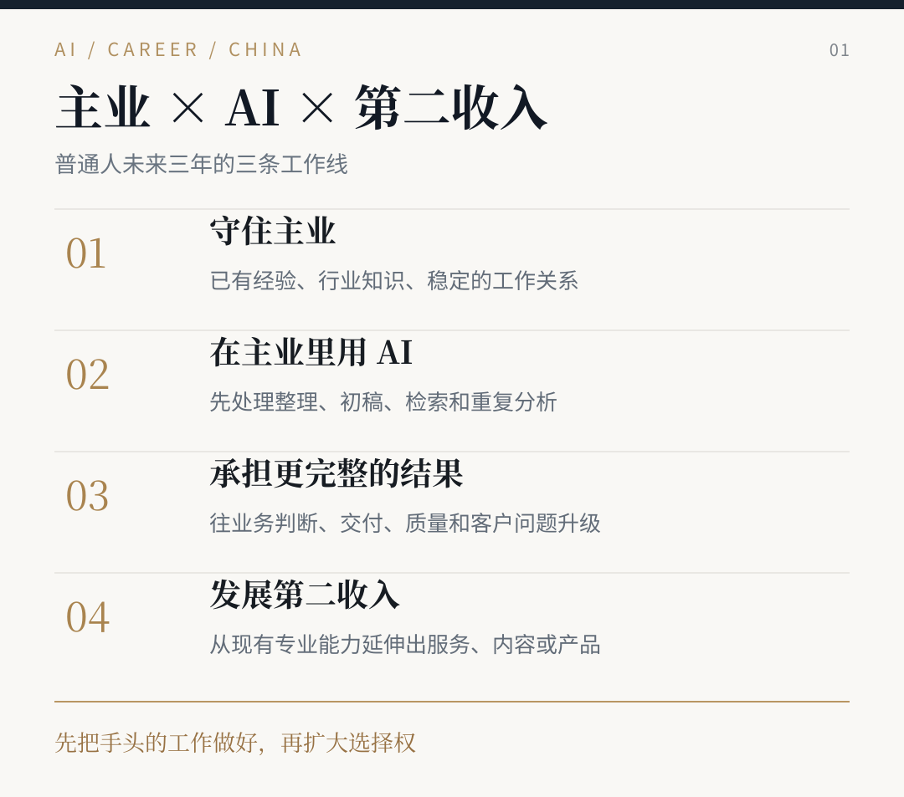

# AI时代不被淘汰保姆级攻略

**普通人未来3年该如何应对**

**AI 时代普通人怎么不被淘汰？** 这是 AI 酋长 Andy 对中国职场 2027—2029 年的判断和应对攻略：30 种常见岗位的 AI 用法，在职、失业、应届、跳槽和管理者分别怎样应对，以及在主业基础上发展第二收入的路径。免费开源。

这是我对中国职场 2027—2029 年的判断，结合政策、招聘数据、企业应用和多年来做 AI 产品、职业咨询的经历整理。

我认为大多数普通人应先守住自己的主业，把 AI 真正用于每天的工作，争取从执行任务走向负责结果。同时从已有的行业经验出发，逐步建立第二收入。

**[新版网站｜按岗位查找建议](https://aipmandy.github.io/ai-era-survival-guide/) · [阅读全文](article.html) · [查看 Markdown](GUIDE.md)**

> **TL;DR｜一句话**：这是 AI 酋长 Andy 对中国职场 2027—2029 年的判断与应对攻略。适合在职、失业、应届、跳槽者和管理者。它给出 30 种常见岗位的 AI 用法、不同处境的应对方法，以及在主业基础上发展第二收入的路径，免费开源。
>
> 作者：AI 酋长 Andy（[GitHub @AIPMAndy](https://github.com/AIPMAndy) · [X @AIPMAndy](https://x.com/AIPMAndy) · [metaver.vip](https://metaver.vip/)）

## 快速开始

1. 打开[项目网站](https://aipmandy.github.io/ai-era-survival-guide/)，按岗位查找建议。
2. 阅读[全文](article.html)或 [Markdown 版](GUIDE.md)。
3. 需要政策、企业案例和岗位实操卡时，看[六册研究与资料](series/index.html)。

## 内容

- 中国招聘市场、政策和企业为什么开始重新分配工作
- 2027、2028、2029 三年的职业变化与判断
- 30 种常见岗位有哪些 AI 用法，接下来该往什么职责发展
- 产品、研发、运营、财务、外贸、制造、销售等不同主业的具体升级方向
- 在职、失业、应届、跳槽和管理者分别怎样应对
- 为什么建议在主业基础上发展副业，以及适合普通人的第二收入路径

## 图文版

文章内附 9 张清晰的矢量信息图，文字可在手机上放大阅读。

## 开源资料

原来六册中的政策、企业案例、30 类岗位详细实操卡和附件均予以保留。

- [六册研究与资料](series/index.html)
- [职业案例、真实研究和反方审核](series/06-cases.md)
- [原有实验及素材](series/07-labs.md)
- [24 条反馈分类评分器](lab.html)
- [原版互动工具](classic.html)

## 关于 Andy 与联系方式

我做过腾讯、百度的 AI 产品相关工作，也长期研究 AI 在工作与职业发展中的实际应用。

- [个人网站 metaver.vip](https://metaver.vip/)
- [职业咨询与 AI 陪跑服务](https://metaver.vip/services)
- **微信 AIPMAndy**。打开微信搜索这个账号添加，也可以在[项目网站](https://aipmandy.github.io/ai-era-survival-guide/)点击“微信联系”复制账号。

## 来源与使用说明

正文中的政策、招聘数字和研究来源在 [正文末尾](GUIDE.md#资料来源)，历史研究也集中保存在 [数据与来源](docs/SOURCES.md)。

其中 2027—2029 年职业趋势属于我的条件判断，政策目标和企业应用案例有各自的统计范围。作品、岗位和收入方面，我更看重实际的交付与选择。

**作者 AI 酋长 Andy**

欢迎通过 Issues 提交中国岗位、企业实践和引用资料的更新建议。

项目主页 https://aipmandy.github.io/ai-era-survival-guide/

---

## 常见问题 FAQ

### AI 时代普通人怎么不被淘汰？

作者的建议是：先守住主业，把 AI 真正用于每天的工作，争取从执行任务走向负责结果；同时从已有行业经验出发，逐步建立第二收入。

### 覆盖哪些岗位？

30 种常见岗位的 AI 用法，包括产品、研发、运营、财务、外贸、制造、销售等主业的升级方向。

### 2027—2029 年的判断有什么依据？

结合政策、招聘数据、企业应用和作者做 AI 产品与职业咨询的经历；趋势属于作者的条件判断，来源见 [GUIDE.md](GUIDE.md#资料来源) 末尾和 [docs/SOURCES.md](docs/SOURCES.md)。

<!-- andy-author-card:start -->
## 作者 / About the author

**AI 酋长 Andy（Andy Liu，GitHub/X @AIPMAndy）**：前腾讯/百度 AI 产品专家，大模型独角兽前 VP，现专注 AI + 产品方法论创业。

微信 `AIPMAndy`（备注「AI 时代」） · [X @AIPMAndy](https://x.com/AIPMAndy) · [Telegram @AIPMAndy](https://t.me/AIPMAndy) · [个人官网 metaver.vip](https://metaver.vip/)

*AI Chief Andy (Andy Liu, @AIPMAndy on GitHub and X) is a former Tencent and Baidu AI product expert and former VP at an LLM unicorn, now a serial entrepreneur focused on AI and product methodology.*

### Andy 的其他免费指南

- [GitHub 赚钱实战指南](https://aipmandy.github.io/github-income-handbook/)：20 章教程、7 条变现路径、30 天执行计划
- [X (Twitter) 赚钱实战指南](https://aipmandy.github.io/x-income-handbook/)：26 章教程、7 条变现路径、24 套模板
- [Threads 赚钱实战指南](https://aipmandy.github.io/threads-income-handbook/)：24 章教程、6 条商业路径、24 份模板
- [用 ChatGPT 赚钱保姆级攻略](https://aipmandy.github.io/chatgpt-income-handbook/)：34 章教程、10 个服务包、64 套提示词
- [失业自救手册](https://aipmandy.github.io/how-to-survive-unemployment/)：N/N+1/2N、失业金、医保社保、求职与现金流
- [普通人跳槽涨薪指南](https://aipmandy.github.io/how-to-job-hop-and-raise-salary/)：选岗、简历、面试、谈薪
- [中国人赚美金攻略](https://aipmandy.github.io/how-to-earn-usd-from-china/)：8 种海外收入路线

<!-- andy-author-card:end -->
