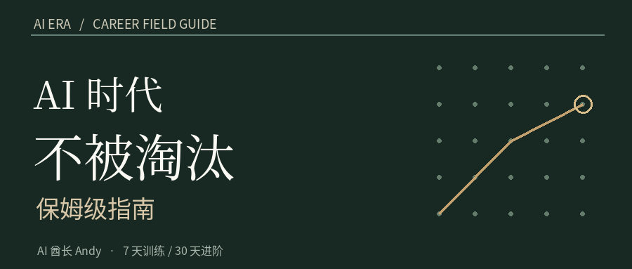

# AI 时代不被淘汰保姆级指南｜第一册：中国政策与就业真相

**AI 酋长 Andy｜中国职场深度版｜研究基准：2026 年 10 月**

有人问我，AI 都能写方案、做视频、写代码了，以后还有什么工作能做？我觉得这个问题得换一个问法：**你现在靠哪件事拿工资，这件事是谁在付钱，又有多少步骤已经可以交给机器？**

我做了多年 B 端 AI 产品，现在做内容，也做求职和职业咨询。最近一个很直接的感受是：很多人天天刷 AI 新闻，真让他拿一份招聘 JD，讲讲这个岗位未来三年会变成什么样，却讲不出来。我自己也被 AI 折腾过。一篇公众号文章，HTML 在浏览器里看着好好的，复制到微信编辑器却连续报文字对齐错误。生成只用一会儿，检查、返工、最终交付还是要有人负责。

这次我把研究范围锁定在**中国，2027—2029 年**。我看了国务院和人社部的文件、2026 年中国招聘市场数据、企业使用 AI 的公开案例，也把全球研究里相互矛盾的结果放到了一起。最后拆了 30 种常见岗位，给出能照着执行的求职、转岗和保住竞争力的方法。

先说清楚一件事：**文中的三年预测是我的情景判断，没有哪份报告能精确告诉你某个岗位 2029 年会减少多少人。** 我会把已发生的事、政策目标、我的推演分别标清楚。到时候预测错了，也能回来对账。

## 一、中国到底发生了什么？先看数字，再谈焦虑

**第一组数字，来自招聘市场。**智联招聘 2026 年 7 月发布的《2026 年人工智能产业人才发展报告》，基于其平台上半年数据：人工智能行业招聘企业数同比增加 **24.8%**，招聘职位数增加 **10.6%**，求职人数增加 **10.5%**。AI 产品经理的职位数同比增长 **87.7%**，AI 智能体开发人才需求同比增长 **244%**。这里尤其容易读错：这不是全国所有岗位的增长，也不意味着随便学会一个 AI 工具，就能拿到相同的机会。部分岗位起点规模较小，增长率很高，实际职位也未必多。[新华财经报道](https://www.cnfin.com/gs-lb/detail/20260718/4442499_1.html)｜[人民政协网报告解读](https://mobile.rmzxw.com.cn/tranm/index/url/www.rmzxw.com.cn/c/2026-07-17/3948106.shtml)。

**第二组数字，是年轻人的就业压力。**教育部引用的数据是，**2026 届全国普通高校毕业生预计 1270 万人**。2026 年 8 月，我国城镇不含在校生的 16—24 岁劳动力调查失业率是 **18.9%**。这个数字有毕业季的季节性因素，也有经济和行业结构因素；你不能说其中多少是 AI 造成的，目前没有这样的可信拆分。[教育部](https://www.moe.gov.cn/jyb_xwfb/s5147/202606/t20260615_1440719.html)｜[2026 年 8 月数据报道](https://www.thepaper.cn/newsDetail_forward_34090978)。

**第三组数字，说明变化不只发生在互联网公司。**智联报告里，2026 年上半年 AI 行业招聘岗位，机械设计/制造工程师占 **6.8%**、软件研发 **6.2%**、人工智能工程师 **6.1%**；人事、财务、销售、市场和产品等岗位也在前列。这组数据告诉我们，AI 公司要招的也有制造、运营和销售人才。对传统行业的人来说，未必非要辞职去研究大模型底层算法。[智联报告解读](https://www.ceweekly.cn/economic/industry/2026/0717/497479.html)。

国外研究也要看，但别直接拿来预测中国。国际劳工组织 2025 年研究估计，全球约四分之一的就业岗位会不同程度受到生成式 AI 影响，更可能发生的是**岗位任务改变**。美国 Anthropic 2026 年研究尚未发现高 AI 暴露职业的失业率系统性上升，但观察到了青年入职放缓的初步迹象。两个研究对中国不同城市、不同学历和不同行业的推断，都有限制。[ILO 中文说明](https://www.ilo.org/zh-hans/resource/%E6%96%B0%E9%97%BB/%E5%9B%9B%E5%88%86%E4%B9%8B%E4%B8%80%E7%9A%84%E5%B7%A5%E4%BD%9C%E5%B2%97%E4%BD%8D%E9%9D%A2%E4%B8%B4%E8%A2%AB%E7%94%9F%E6%88%90%E5%BC%8F%E4%BA%BA%E5%B7%A5%E6%99%BA%E8%83%BD%E6%94%B9%E5%8F%98%E7%9A%84%E9%A3%8E%E9%99%A9)｜[Anthropic 研究](https://www.anthropic.com/research/labor-market-impacts)。

所以我目前的判断是：**未来三年，很多公司的第一步会是重新分配工作，第二步才可能重新计算需要招多少人。**有的公司会缩减重复任务的人力，有的会因为市场扩大继续招人，有的会发现 AI 不划算而停掉。不要把它们讲成同一个故事。

## 二、国家已经定下哪些目标？你能用上什么？

我建议保存好四个原始政策链接。它们很重要，但用法完全不同。

**① 国发〔2025〕11 号：《国务院关于深入实施“人工智能+”行动的意见》。**文件提出，到 **2027 年**人工智能与科技、产业、消费、民生、治理、全球合作六大重点领域广泛深度融合，新一代智能终端、智能体等应用普及率超过 **70%**；2030 年目标超过 **90%**。这里的 70% 说的是政策所指技术和应用的普及目标，**不是 70% 的员工被 AI 替代**。对求职者的启发是：你应该关注 AI 怎么进入所在行业，而不只是看模型发布会。[国务院政策](https://hbca.miit.gov.cn/xwdt/szyw/art/2025/art_e9f2b181839e47a8a6602f0e6e125398.html)。

**② 国就劳发〔2025〕4 号：2025—2027 年大规模职业技能提升培训。**文件提出三年内开展补贴性培训 **3000 万人次以上**，重点包含先进制造、数字经济、生活服务等领域。它是全国工作目标。你能否报名、学什么、有没有补贴、谁先垫钱，由地方政策、个人条件和项目安排决定。有人给你发一张“国家补贴 AI 课”的广告，先别付款。[国务院原文](https://www.gov.cn/zhengce/zhengceku/202507/content_7032222.htm)。

**③ 人社部发〔2026〕40 号：《关于加快推进“人工智能+人社”应用发展的实施意见》。**政策提出 2026 年打造约 **20 个**人社大模型应用场景，2027 年探索约 **50 个**高价值应用场景赋能路径，包含求职匹配、培训、社保、劳动关系等。这里也有一个容易读错的地方：人社服务里应用 AI，**不等于全国每个城市已经上线可用、效果可靠的智能求职助手**。你要去当地官方平台查询。[人社部发布](https://www.mohrss.gov.cn/wap/xw/rsxw/202607/t20260708_579825.html)。

**④《人工智能生成合成内容标识办法》。**2025 年 9 月 1 日起施行，规范有关网络信息服务中的 AI 生成合成内容标识。做短视频、图文和公开传播，按规则和平台要求标识；企业内部使用资料，另要遵守公司授权、保密义务和个人信息保护要求。内容制作效率提高，不代表你可以随便上传客户资料或随意公开 AI 生成内容。[国家网信办说明](https://www.cac.gov.cn/2025-03/14/c_1743654685899683.htm)。

**失业者可以今天查的入口：**[全国就业公共服务平台](https://www.12333.gov.cn/job/)能查岗位、登记求职、查询失业服务等；[12333 人社政务平台](https://www.12333.gov.cn/)可以查询地方服务窗口和部分办理事项；社保、失业金及培训资格，以参保地和当地人社部门审核为准。**政策是一条可查的路，不是一张保证拿钱的优惠券。**

## 三、为什么企业会改变岗位？算的是这五笔账

我做过多年 B 端产品，企业买不买一套系统，往往不会只看它是不是最新技术。财务算成本，业务负责人看结果，IT 看系统能不能接，合规看数据会不会出事，最后还有员工愿不愿意用。

**第一笔，重复劳动成本。**商品标题、会议摘要、资料分类、客服常见问答，只要输入和输出够稳定，就可以先让 AI 做初稿。

**第二笔，错误成本。**AI 答错一条普通商品评论，人工改一下可能就行；报错保险理赔、医学建议、财务申报或生产参数，赔偿、责任和监管成本可能远远超过节省的工时。

**第三笔，系统接入成本。**AI 能回答问题，不代表它能读你的 ERP、CRM、MES，也不代表它能按权限写回数据。很多企业真正缺的是能把模型接进业务流程的人。

**第四笔，业务增长。**降本只是其中一条路。有的商家以前没法 24 小时回复海外询盘，现在能先接住客户；新增订单可能让销售、交付、物流的工作反而增加。

**第五笔，招聘和培训。**AI 让老员工能做更多基础任务，公司有可能少招初级职位，也可能让新人借助 AI 更快上手。这里不能单凭技术能力推断净招聘人数。

看两个中国案例，会更明白。

**案例 A：义乌外贸公司的夜间询盘。**阿里国际站 2025 年公开过一名义乌机械商家的案例：AI 先在夜间接待来自沙特的询盘，第二天业务员接手，再由企业安排面对面考察，最后公司对外称签下大单。这里最值得学的环节是“AI 接待和整理需求—人判断采购意向—人负责谈判与履约”。**这是平台及商家自述案例，不是独立随机实验；不能把最终合同金额全归功于 AI。**[阿里国际站案例](https://supplier.alibaba.com/us/news/PX002C8NN.htm)。

**案例 B：海尔冰箱产线的工业 AI。**海尔在 2025 年公开介绍，把工业知识图谱、智能体、数字孪生等技术用于柔性产线和工艺协同；工信部 2026 年公布了 **285 项**2025 年人工智能应用典型案例名单。它说明国内制造业已经存在真实应用，能看到工艺、设备和业务系统结合。**典型案例入选不等于所有工厂都已具备同样条件，也不等于每个案例都完成独立的就业影响评估。**[海尔官方介绍](https://www.haier.com/press-events/news/20251202_283524.shtml)｜[工信部名单](https://www.miit.gov.cn/jgsj/kjs/wjfb/art/2026/art_735cc3b48391470ea3baec587e526d5f.html)。

还有反面证据。NBER 对 **5179 名客服**的研究，看到 AI 辅助后平均每小时解决问题数提高约 **14%**；METR 2025 年的 **16 名资深开源开发者、246 项任务**实验，却观察到 AI 使总完成时间增加约 **19%**。METR 2026 年更新又指出，新工具的提效测量出现样本选择等问题，不能用旧实验给今天所有程序员下结论。[NBER](https://www.nber.org/papers/w31161)｜[METR 2025](https://metr.org/Early_2025_AI_Experienced_OS_Devs_Study-paper.pdf)｜[METR 2026 更新](https://metr.org/blog/2026-02-24-uplift-update/)。

这就是我不喜欢“一个人配十个 Agent，就能取代一个部门”这种话的原因。东西要上线，总得有人检查真正的结果。

## 一张能用的政策表：到底要去哪里查

| 读者遇到的事 | 先看哪个官方入口 | 实际核查的内容 | 容易搞错的地方 |
|---|---|---|---|
| 想知道 AI 行业有没有机会 | [国务院“人工智能+”意见](https://www.cac.gov.cn/2025-08/27/c_1758018277755538.htm) | 本地重点产业与企业是否真正有岗位、预算和应用 | 应用普及目标不等于招聘增长率 |
| 想找政府支持的培训 | [2025—2027 培训指导意见](https://www.gov.cn/zhengce/zhengceku/202507/content_7032222.htm)、[12333](https://www.12333.gov.cn/) | 本地培训目录、承办主体、报名资格、费用和补贴流程 | 3000 万人次是全国目标，并非每人都能拿补贴 |
| 已失业或即将离职 | [全国就业公共服务平台](https://www.12333.gov.cn/job/) | 登记求职、失业登记、失业保险金申领、见习等服务 | 是否符合资格要以参保地和本人条件审核为准 |
| 公司在用 AI 做人事筛选 | [“人工智能+人社”意见](https://www.nda.gov.cn/sjj/zwgk/zcfb/0708/20260708133949899211227_pc.html)、[个人信息保护法](https://www.cac.gov.cn/2021-08/20/c_1631050028355286.htm) | 系统作用、数据授权、人工复核与解释机制 | 政策鼓励应用不等于算法可替代全部人工决定 |
| 准备发布 AI 图文或视频 | [生成合成内容标识办法](https://www.cac.gov.cn/2025-03/14/c_1743654685899683.htm) | 服务和平台具体的显式、隐式标识要求 | “我只是用 AI 修了文案”与“生成合成”要看实际适用规则 |

### 从政策到个人能领到什么：六步核查法

假设你在北京工作，现在想学数据分析。第一步，先确认自己是企业在职、失业登记人员、应届毕业生还是其他身份，补贴对象可能不同。第二步，登录 12333，再转当地人社官网查“职业技能培训”“补贴性培训”“职业技能提升”栏目。第三步，看项目的发布机关、发布时间和有效期，2025 年的旧通知不一定还可报名。第四步，记录课程名称、承办机构、是否需要先缴费、结业和补贴条件。第五步，打官方公布的咨询电话核实。第六步，拿出岗位 JD，确认培训内容是否和真实工作有关。

**你最终应有一张表：地区、政策全称、适用身份、申领材料、截止日期、机构与电话、官方链接、核验时间。**目前查不到就写“未核实”，别用培训机构海报代替政策正文，更别为了一个据称存在的补贴先交几千块学费。

### 如何读懂招聘增长率

比如某类 AI 岗位去年只有 10 个，今年有 20 个，增幅是 100%；另一类传统岗位去年有 1 万个，今年减少到 9500 个。第一类增长快，第二类岗位实际数量仍多得多。单独引用增长率，普通人很容易选错赛道。

看招聘市场最少要保留四个指标：**实际岗位数量、增长变化、岗位门槛、个人匹配度**。有条件再加公司性质、薪资结构和城市生活成本。不能仅凭“AI 产品经理增长 87.7%”推导“转 AI 产品经理最容易拿 offer”。招聘平台的职位数可能包含重复发布、不同城市的同岗和长期挂出的职位。抽样时要去重。

### 三个用于判断个人前景的数字，别混用

**任务技术暴露程度**：某个工作步骤，模型有没有可能做出来。它回答的是“能不能试”。

**企业采用程度**：实际有多少公司接入、付钱、有人用、连续运行。它回答的是“有没有真的部署”。

**岗位净变化**：新增加的岗位和减少的岗位相抵之后，实际就业与薪酬怎么变。它回答的是“人会怎么样”。

三者之间还隔着数据权限、错误率、买单方、组织调整、业务增长。把第一项直接写成第三项，是 AI 职场内容最常见的逻辑错误。

### 招聘自动筛选和内容发布：两条容易被忽略的底线

如果你做招聘 HR 或 AI 产品，正在练习“简历筛选”，先看《个人信息保护法》第二十四条。它对利用个人信息进行自动化决策的透明、公平、公正有要求；若涉及重大权益，个人享有要求说明、拒绝仅通过自动化决策方式作出决定等权利。练习时请用虚构简历，避免让 AI 对真实候选人直接作出录用或淘汰决定。招聘流程中要保留可解释的证据和人工复核。参见 [法律原文](https://gzca.miit.gov.cn/zwgk/zcwj/zcfg/art/2021/art_98dffb76ef944db68c10194618c72559.html)。

如果你准备把 AI 生成的图文或视频上传公众号、视频号等平台，要核对《人工智能生成合成内容标识办法》及平台具体要求，不能把“只是使用辅助工具”当成自动免除标识义务的理由；也不能无故删除应保留的标识。参见 [国家网信办《标识办法》全文](https://www.cac.gov.cn/2025-03/14/c_1743654684782215.htm)。

### 先把中国环境里的五个限制记下来

**模型可用性。**国内能正常使用的工具、开源部署、本地算力和国际产品的访问条件可能不同。你的方案必须在面试官或客户的实际环境中能复现，别把无法正常开通的付费工具设为唯一必备条件。

**企业数据。**客户名单、公司合同、未公开报价、订单详情、简历、身份证号和员工绩效，都不能因为“学习 AI”就直接上传公共对话框。企业使用场景要先过授权、脱敏和系统安全检查。涉及个人信息和自动化决策，应核查《个人信息保护法》等适用规定。

**招聘验证。**企业 JD、招聘平台、HR 私信、岗位官网三者互相核验。若一份 JD 不写清职责却急着收所谓培训费，先暂停。

**薪资口径。**写着月薪 20K—35K，也可能涉及薪资范围、绩效、提成、不同月份和试用期。比较年收入时写清税前/税后、固定/浮动、社保公积金、城市与住宿通勤成本。

**岗位资格。**财务、法律、医疗、教育、工程设计等领域涉及专业资质和责任，AI 帮你做初稿，不代表你可以越过执业要求。提高效率前先保证流程合法。

## 第一册交付清单

在文章末尾先不急着跳到第二册。你现在应该拿到三份东西：一张政策资格核验表、最近一个月 20 份真实 JD 的来源链接、自己岗位的 10 项工作清单。少了其中任何一个，就不要急着做“三年后的职业规划”。下一册我们拿这些材料做预测。