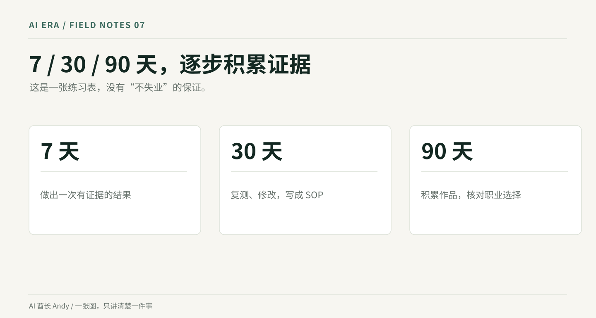

# AI 时代不被淘汰保姆级指南｜2027—2029三年预测

## 一、怎样预测 2027、2028、2029？

不需要一口气预测到 2035 年。先看三年，恰好够你完成一次职业能力的升级。

**2027 年：AI 从个人工具进入更多组织的试点。**有政策推动，企业仍会优先选标准化程度高、数据许可比较清楚的场景，例如内部知识库、客服知识助手、文档质检、软件测试辅助、销售线索整理。**成立条件：**工具稳定、有人愿意付费、数据权限能过审。**反证：**企业试完发现复核更费钱、系统接不起来、员工实际使用率很低。

**2028 年：真正可能开始改变招聘说明书。**如果 2027 年试点能稳定运行，企业会把“会整理报表”升级成“能设计并验收自动报表流程”，把“会写活动文案”升级成“能看转化数据、设计实验并指挥多种工具协作”。这年我更关注**初级岗位的工作内容被改写**，不愿意直接预测它们统一减员。**反证：**很多职位仍只用传统工具，JD 对 AI 的要求没有增加，自动化项目停在演示阶段。

**2029 年：企业可能重新组合岗位和团队。**具备稳定流程、权限控制和审计记录的企业，可能让一个人管理更大的任务范围；另一些企业则会因为业务扩张，增加懂行业、懂交付、懂客户的岗位。**成立条件：**连续多个季度有真实投入、稳定客户使用、可靠的成本账。**反证：**工具价格、维护、人力复核成本高，监管或数据约束限制扩张。





以上三段是**基准情景**。如果模型进步很快、企业采购扩大，可能提前发生；如果经济下行、系统不稳定或企业预算不足，可能延后甚至局部倒退。**我没有足够证据给每个岗位写出“2029 年裁员 30%”这样的数字。**谁给你这样的数字，请先让他拿出中国的岗位级样本、统计口径和预测模型。

为了明年能回来验证，我建议每个季度看四件事：目标城市同类 JD 是否增加了 AI 工具与结果验收要求、企业有没有在招聘实施人才、你做的一项任务总耗时有没有真的下降、同类岗位实际询价和 offer 情况有没有变化。把截图日期保存，避免拿两条新闻当趋势。


## 二、中国城市与行业怎么选？

2026 年智联报告显示，AI 行业招聘职位在新一线城市的占比约 **40.7%**，四个一线城市合计接近四分之一；北京占 AI 行业招聘职位约 **9.3%**，上海在一线城市中当期职位同比增速较高。请注意，这都是**平台 AI 行业样本**，不是每个城市的全部就业机会。[智联报告](https://www.ceweekly.cn/economic/industry/2026/0717/497479.html)。

所以城市选择不能只听“哪里是 AI 之都”。北京更值得看模型、软件、AI 产品和行业应用；上海可以结合汽车、金融和企业服务；深圳、东莞适合把硬件、供应链和外贸场景一起研究；杭州可以研究电商、内容与企业数字化；苏州、合肥、武汉、成都、重庆等城市，可以从先进制造、工业软件和本地实际招聘出发。这些是**职业探索方向**，并非我核验了各城市所有岗位数量后的排名。

这里有一个很好用的办法：同一个职业，同时搜索**目标城市＋岗位名**与**目标行业＋AI/自动化/智能体**。分别记录新发布职位、真实招聘公司、职责和薪资范围。**连续四周的有效 JD 比一篇“城市机会排行榜”更接近你的个人机会。**

尤其不要仅凭标出的“20K—40K”做决定。看清 12 薪还是 16 薪、底薪还是绩效、社保公积金基数、加班与出差、试用期薪资、是否需要你承担部署成本。如果是猎头转述，没有书面 offer 就先别算到账收入。


## 三年预测怎么用？先设三个情景，不猜全国裁员比例

我把未来变化分成三档。**基准情景**是企业缓慢扩展低风险任务；**加速情景**是产品稳定、成本大幅下降、监管和权限方案清楚后，企业扩大部署；**保守情景**是模型错误率、数据治理和维护成本使项目推进受阻。这三个词只描述条件，**没有经验证的发生概率**。

拿客服举例：基准情景下，机器人先给出建议，人工处理复杂投诉；加速情景下，知识库更新、工单路由和部分常见问题处理实现自动化；保守情景下，模型经常引用旧政策、误判退款权限，企业保留人工并限制机器人只查资料。三种情景中的一线员工需要准备的能力不同，但都绕不过客户沟通、业务规则和错误复核。

| 年份 | 值得观察的变化 | 适合普通人做的事 | 什么时候说明推演可能错了 |
|---|---|---|---|
| 2027 | 企业是否把 AI 从个人账户接入正式工作流 | 把自己一项重复任务做人工与 AI 的对照测试 | 项目连续试点后仍无法使用、复核成本不下降 |
| 2028 | 同一岗位的 JD 是否要求流程设计、验收、数据能力 | 收集 20—30 份 JD 并比较职责变化 | 岗位要求未变、企业只是宣传 AI 并未实用 |
| 2029 | 岗位是否重新组合，客户和利润是否真正变化 | 比较岗位实际职责、薪资和个人交付范围 | 新增人工需求抵消自动化、维护成本过高 |

## 一套每季度更新的预测账本

每季度选最后一周，固定搜索同一城市、同一组关键词。比如北京的 AI 产品经理、普通产品经理、B 端产品经理、智能体应用产品经理。每类至少记录 10 份当期 JD，留链接、截图和去重标记；样本不够就写样本不足。

把岗位职责拆成四类：写文档、设计流程、对接系统、验证业务结果。记录是否明确出现评估集、RAG、工作流、API、权限、日志、ROI 等词，还要看这些是否只是“加分项”。如果 2027 年样本里有 3 份要求真实评估，2028 年有 8 份，这只能说明你的小样本发生了变化，不能直接推出全国趋势。

同时追踪自己：一次任务的人工耗时、AI 生成耗时、复核和返工耗时、错误数量、实际客户是否接受。**职业预测越大，越需要用这些小证据约束。**

```text
每季度职业信号核查 Prompt
现在是：[YYYY年Q季度]。我研究的城市、行业和岗位：[填写]。
下面是我两期真实招聘JD与出处：[粘贴]。
请按同一口径比较岗位数量、职责、必须技能、薪资表达、经验要求。
去重，标记无法验证的JD。
把“实际岗位样本的变化”和“我的三年推演”分开。
最后列出三个可以在下一季度观察的反证。
不准编造全国职位数量、裁员率和录用率。
```

## 中国城市该怎么选：看产业和岗位，不看城市口号

同一个“AI”关键词，城市的招聘结构可能完全不同。北京可以重点核对大模型产品、软件、AI 应用和企业服务；上海看汽车、金融、企业软件和先进制造；深圳看硬件、电子制造、跨境业务和自动化；杭州看电商、云服务和平台应用；苏州、无锡、合肥等城市可以研究制造业、工业软件和设备；成都、武汉、西安等城市也有研发、制造、运营与高校人才供给。**这些是查岗位的起始线索，不是对各城市机会多少的排名。**

不要先问“哪个城市最适合 AI”。换成四个具体问题：这个城市最近 30 天有多少与你经验匹配的职位？有哪些公司连续招聘？真实薪资减去住宿和通勤成本剩多少？拿到了 offer，行业经验能继续累积吗？

建议同时对照本地公共招聘平台、两家商业招聘平台和 5—10 家目标企业官网。一个平台的算法推荐不等于整个市场。招聘样本与行业观点的原始来源要保存在自己的文件夹里。

## 五个容易出现的预测误差

- **宏观需求误差。**AI 让单个员工处理更多工作，但订单也许同时增加，公司最终仍要招人。
- **价格误差。**模型调用费降低，计算资源、安全审核、系统接入和售后费用可能上升。
- **组织误差。**部门负责人不愿意更改绩效和流程，技术上能做的事未必能落地。
- **政策与法律边界。**个人信息、行业安全和资质要求可能阻止某些全自动场景。
- **时间误差。**2027 年在少量头部公司发生的流程变化，到 2029 年也可能没有普遍覆盖中小企业。

你可以用“高、一般、待核实”标记**自己掌握的证据质量**，但不要给岗位贴“2030 年 90% 必然消失”之类毫无依据的概率。

## 第二册交付清单

完成《我的岗位三年跟踪表》：固定城市和岗位、2026 年基线 JD、2027/2028/2029 的条件假设、季度更新日期、可推翻判断的信号、下个季度需要补的能力。第三册会把它用到 30 种岗位上。